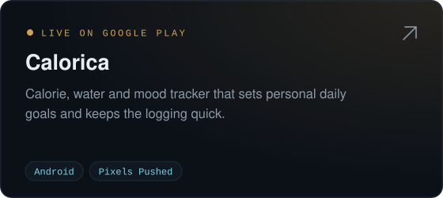
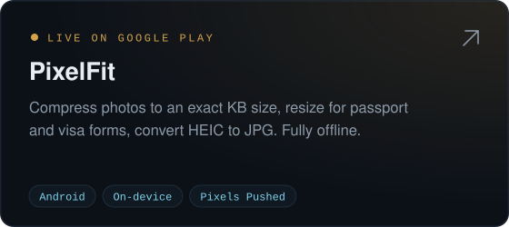
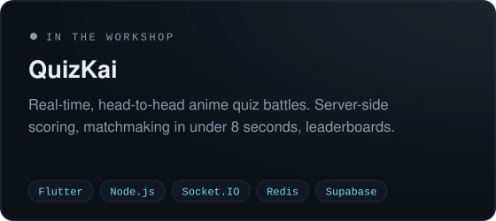
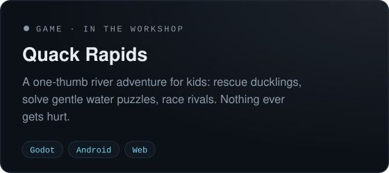
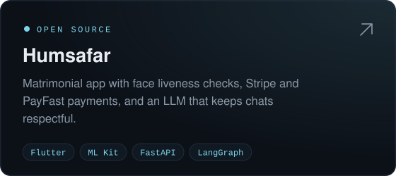
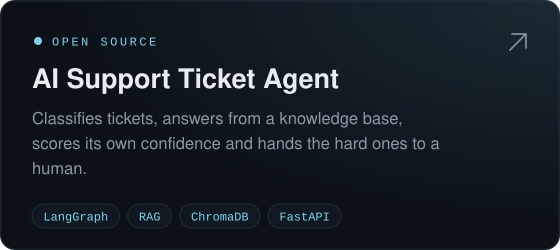
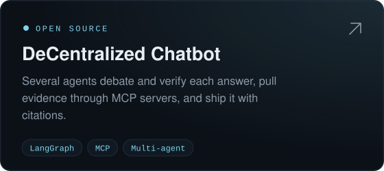
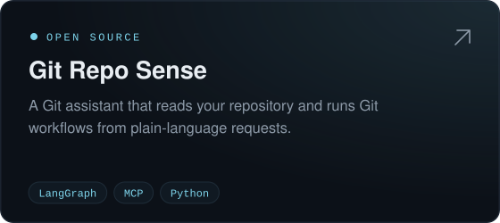

  

  
  
  

 

I build apps and AI agents, and I'd rather show them than talk about them.

I study Computer Science at **COMSATS Islamabad** (2023–2027). Outside class I run **Pixels Pushed**, a small studio with two apps live on Google Play. Before that I was an app developer at **Kollab** (Nov 2025 – Apr 2026), keeping a production app stable and shipping new features.

I work mostly in **Flutter**, sometimes **Kotlin**. Lately I build agents with **LangGraph**, the kind that check their own answers and know when to hand off to a person.

### Shipped

  
  

### In the workshop

  
  

### Open source

  
  

  
  

Also on the shelf: <a href="https://github.com/ShahmeerAli/Face-Detection-Google-MLKit">Face liveness with ML Kit</a> · <a href="https://github.com/ShahmeerAli/Animation-Turf">Animation Turf</a> · <a href="https://github.com/ShahmeerAli/Research-Agent">Research Agent</a> · <a href="https://github.com/ShahmeerAli/YT-RAG-BASED-AGENT">YouTube RAG Agent</a> · <a href="https://github.com/ShahmeerAli/JAIB-KHARCH">Jaib Kharch</a>

 

### Tools

  
   
  

<code>LangChain</code> <code>LangGraph</code> <code>RAG</code> <code>MCP</code> <code>ChromaDB</code> <code>Jetpack Compose</code> <code>Room</code> <code>Socket.IO</code>

 

### Off the clock

Anime that takes its time. Moody mountain photography. Old architecture that still feels alive.

If you have something worth building, [email me](mailto:shahmeer.devel@gmail.com) or find me on [LinkedIn](https://www.linkedin.com/in/shahmeer-ali-9a09b3327).

 

  

